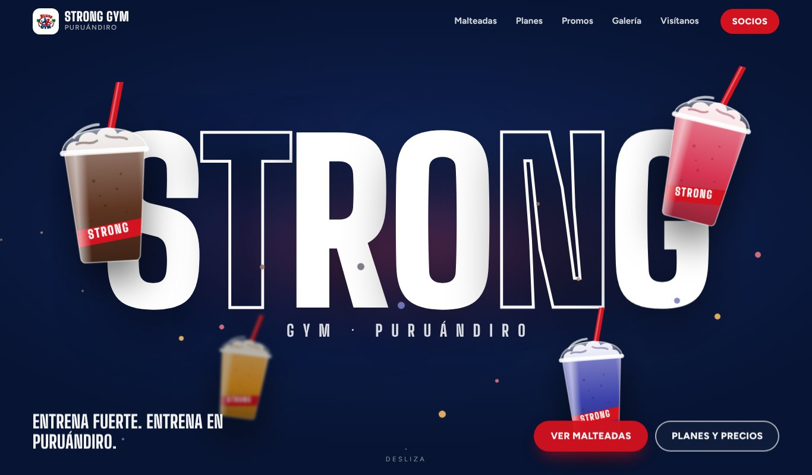
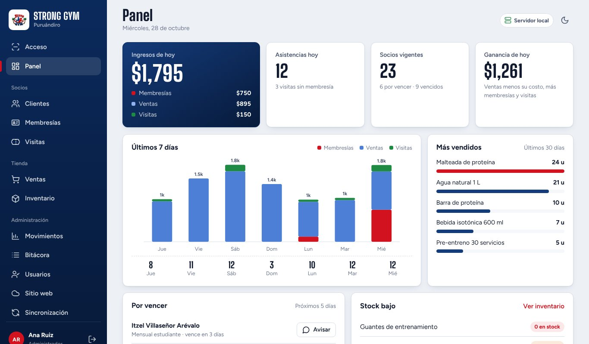
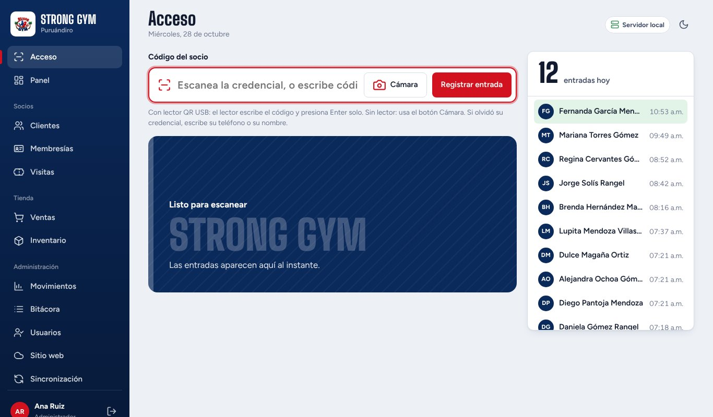
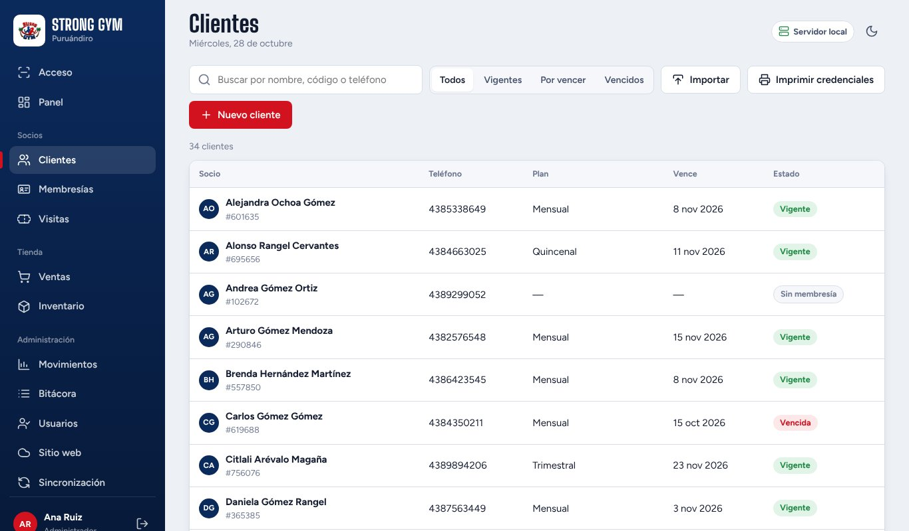
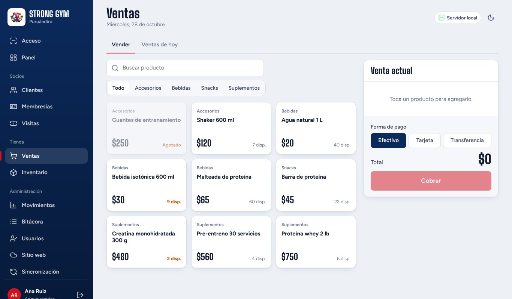
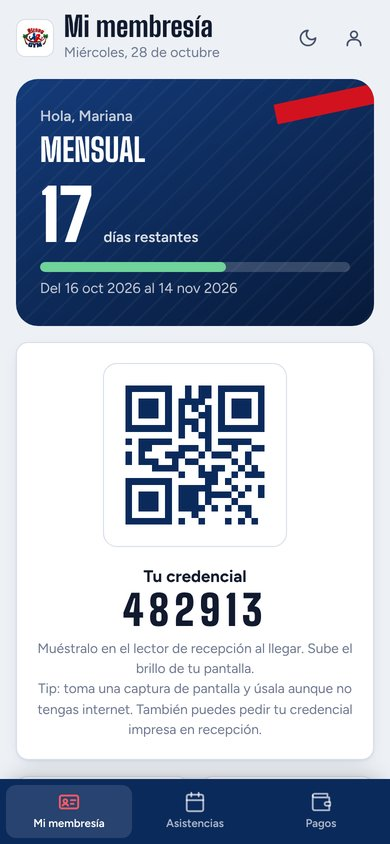

# Strong Gym Puruándiro · Sistema de gestión y sitio web

Sistema completo para un gimnasio real de Puruándiro, Michoacán: **control de acceso con QR, membresías, punto de venta, inventario, reportes y portal del socio**, más el **sitio web público** del gimnasio, editable desde el propio sistema.

Funciona **sin internet** en la computadora de recepción y se **sincroniza con la nube** cada 60 segundos, así que el dueño puede consultar todo desde su celular.



## Capturas

| Panel del administrador | Control de acceso con QR |
|---|---|
|  |  |
| **Clientes y membresías** | **Punto de venta** |
|  |  |

<p align="center"><br><sub>Portal del socio (móvil): días restantes, credencial QR, asistencias y pagos</sub></p>

## Funcionalidades

**Recepción y administración** (`/app`)
- Registro de entrada con lector QR USB o cámara, y búsqueda por teléfono o nombre.
- Clientes con foto, membresías (alta, renovación, vencimientos), visitas sin membresía e impresión de credenciales.
- Punto de venta con carrito y formas de pago, inventario con alertas de stock bajo.
- Panel con ingresos del día, asistencias, socios vigentes, ganancia, gráfica de 7 días y productos más vendidos.
- Movimientos, bitácora de acciones, usuarios y respaldos.
- Importación de socios desde CSV (migración del sistema anterior).

**Roles**: administrador (todo), dueño (solo lectura, validado en el servidor) y socio (su portal).

**Sitio web público** (`/`): animado, con planes, promociones, galería, productos y contacto; los textos e imágenes se editan desde el sistema, sin tocar código.

## Tecnologías

| Capa | Tecnología |
|---|---|
| Backend | Node.js 22 (servidor HTTP propio, sin dependencias externas) |
| Base de datos | SQLite (`node:sqlite`), local y en la nube |
| Frontend | HTML, CSS y JavaScript (sin frameworks), generador de QR propio |
| Sincronización | Recepción ⇄ nube por revisión y fecha de actualización, con token |
| Despliegue | Docker, Docker Compose + Caddy (HTTPS) en VPS, o Render |
| Pruebas | `node:test`, prueba de punta a punta de recepción + nube |

**Seguridad:** contraseñas con scrypt, sesiones en cookie HttpOnly, límite de intentos de inicio de sesión, Content Security Policy, fotos de socios privadas y sincronización autenticada.

## Probarlo en local

```bash
npm run demo     # datos de ejemplo en http://localhost:3000
npm test         # pruebas automáticas
```

Accesos de la demo: `admin / admin1234`, `dueno / dueno1234`, socio `482913 / socio1234`. Los datos de la demo son ficticios.

---

# Guía de instalación y uso

## 1. Cómo está pensado

```
  Recepción (computadora del gym)              Nube (internet)
  ┌──────────────────────────────┐             ┌─────────────────────────────┐
  │ Sistema completo             │  cada 60 s  │ Sitio web para clientes     │
  │ Funciona SIN internet        │ ──────────▶ │ Portal del socio            │
  │ Lector QR / cámara           │ ◀────────── │ Dueño consulta desde el cel │
  │ Base de datos local + respaldo│             │ Base de datos en la nube    │
  └──────────────────────────────┘             └─────────────────────────────┘
```

- Si se va el internet en el gym, **recepción sigue trabajando** y se pone al día sola cuando vuelve.
- Si solo quieren usar la nube (sin computadora local), también funciona: abran `https://su-sitio/app` desde recepción.

**Roles**
| Rol | Usuario inicial | Qué puede hacer |
|---|---|---|
| Administrador (recepción) | `admin` | Todo: acceso, cobros, ventas, clientes, sitio web |
| Dueño | `dueno` | Ve todo, **no modifica** nada |
| Socio | su número de socio o teléfono | Su portal |

La primera vez que arranca, las contraseñas se muestran en pantalla y se guardan en `datos/CREDENCIALES-INICIALES.txt` (o usa las que pongas en `.env`). Cámbienlas en **Mi cuenta**.

---

## 2. Instalar en la computadora de recepción (Windows)

1. Instala **Node.js LTS** desde <https://nodejs.org/es/download> (Siguiente, Siguiente, Finalizar).
2. Copia la carpeta `strong-gym` a la computadora, por ejemplo en `C:\StrongGym`.
3. Doble clic en **`INICIAR-STRONG-GYM.bat`**. Se abre el navegador en `http://localhost:3000/app`.
   - Deja esa ventana negra abierta (puedes minimizarla).
4. (Recomendado) Doble clic en **`INICIO-AUTOMATICO-WINDOWS.bat`** para que arranque solo al prender la computadora.
5. En Chrome o Edge: menú ⋮ → *Instalar Strong Gym* para tenerlo como aplicación.

Mac o Linux: `./iniciar.sh`

> Los datos viven en la carpeta `datos/`. **No la borres.** Ahí también se guarda un respaldo diario (`datos/respaldos`, últimos 14 días). Cópialos a una USB o a Drive de vez en cuando.

---

## 3. Subir a la nube

Necesitas un servidor que corra Node.js o Docker **con disco que no se borre** (ahí vive la base de datos). Dos caminos:

### Opción A · Hostinger VPS (recomendada para quedarse)

El plan **"Web hosting Business"** de Hostinger también acepta Node.js, pero **no sirve para este sistema**: en cada actualización reemplaza los archivos y apaga la app cuando no hay visitas, así que la base de datos se puede perder. Usa un **VPS** (el más chico, KVM 1, alcanza).

1. Compra el VPS y elige la plantilla **Ubuntu con Docker** (en hPanel: VPS → Sistema operativo → *Docker*).
2. En tu dominio (Hostinger → Dominios → DNS) crea un registro **A** con `@` apuntando a la IP del VPS (y otro `www` si quieres). Tarda de minutos a unas horas.
3. Entra al VPS desde hPanel → *Terminal del navegador* (o `ssh root@IP`) y ejecuta:
   ```bash
   git clone https://github.com/TU-USUARIO/strong-gym.git
   cd strong-gym
   cp nube.env.example .env
   nano .env          # pon DOMINIO, SYNC_TOKEN (openssl rand -hex 24) y las contraseñas iniciales
   docker compose up -d --build
   ```
4. Abre `https://tu-dominio`. El candado (HTTPS) se pone solo.
5. Para actualizar cuando cambies algo: `./actualizar-vps.sh` (los datos no se tocan).

Si el repositorio es privado, GitHub te pedirá usuario y un *token* en lugar de contraseña (GitHub → Settings → Developer settings → Personal access tokens). También puedes subir el zip por el administrador de archivos y descomprimirlo.

Ver qué pasa: `docker compose logs -f app` · Reiniciar: `docker compose restart app`.

### Opción B · Render (la más rápida para probar)

1. Sube esta carpeta a un repositorio privado de GitHub (el `.gitignore` ya evita subir la base de datos).
2. En <https://render.com>: **New → Blueprint** → elige el repositorio. Render lee `render.yaml` y crea todo.
3. Escribe `ADMIN_PASSWORD_INICIAL` y `DUENO_PASSWORD_INICIAL` cuando lo pida.
4. Te da una dirección tipo `https://strong-gym.onrender.com`. Puedes conectar tu dominio en **Settings → Custom Domains**.

Costo aproximado: plan *Starter* (≈ 7 USD/mes) + disco (0.25 USD por GB al mes). El plan gratis no sirve (no permite disco).

**Mudarse de Render a Hostinger después** es sencillo: levanta el VPS vacío, cambia `NUBE_URL` en el `.env` de recepción por la nueva dirección y reinicia. Recepción detecta el cambio y le envía toda la información a la nube nueva.

## 4. Conectar recepción con la nube

1. En Render, en **Environment**, copia el valor de `SYNC_TOKEN` (se generó solo).
2. En la computadora de recepción abre el archivo `.env` con el Bloc de notas y llena:
   ```
   NUBE_URL=https://strong-gym.onrender.com
   SYNC_TOKEN=(el mismo valor de Render)
   ```
3. Cierra la ventana negra y vuelve a abrir `INICIAR-STRONG-GYM.bat`.
4. En el sistema, **Sincronización** debe decir "Hace unos segundos". Ahí mismo hay un botón *Sincronizar ahora*.

Qué viaja: clientes, fotos, membresías, pagos, entradas, ventas, inventario, bitácora, usuarios, sitio web y malteadas. Si algo se editó en los dos lados, gana el cambio más reciente.

---

## 5. Control de acceso con QR

Al registrar un cliente se genera su **código de socio (6 dígitos)** y su **QR fijo**. El QR no cambia al renovar: se imprime una vez.

**Imprimir credenciales**
- Cada credencial tiene **frente** (foto, nombre, número y QR) y **reverso** (horario, WhatsApp, dirección y un texto al pie que se edita en *Sitio web → Información y contacto*). El reverso se puede quitar al imprimir.
- **Hoja carta**: 8 por hoja; si incluye reverso sale una segunda hoja acomodada en espejo. Imprime a doble cara ("voltear por el borde largo") o imprime las dos hojas y pega frente con reverso antes de enmicar.
- **Impresora de credenciales PVC** (Zebra, Evolis, etc.): una tarjeta por página en tamaño CR80; elige márgenes "Ninguno" y doble cara si tu impresora la tiene.
- Al dar de alta aparece su credencial → *Imprimir credencial*.
- Para varias a la vez: **Clientes → Imprimir credenciales** (8 por hoja carta, con línea de corte). Recorta y enmica; **mica mate** de preferencia (la brillante refleja y el lector tarda más).
- Si alguien pierde la credencial, se reimprime igual. Si sospechan que otra persona la usa: ficha → credencial → *genera un QR nuevo* (la anterior deja de funcionar).

**Al llegar el socio**, recepción tiene tres formas, de la más rápida a la de respaldo:
1. **Lector QR USB (recomendado).** Se conecta como teclado: pasa la credencial, escribe el código y da Enter solo. Lee en menos de un segundo, aun con mica, y no necesita internet. Busca uno "2D/QR, USB" (cuestan aprox. 400–900 MXN).
2. **Cámara de la computadora**: botón *Cámara* en Acceso. Funciona, pero las webcams de laptop enfocan mal de cerca; úsala como respaldo. La primera vez necesita internet para descargar el lector.
3. **Sin credencial**: escribir código, teléfono o nombre.

El socio también puede mostrar su QR desde el portal en el celular.

**Foto del socio**: al registrarlo (o en *Editar*), *Tomar foto*. Aparece grande en pantalla cada vez que escanea, así recepción confirma que la credencial es suya. La pantalla se pone **verde** (pasa), **naranja** (por vencer) o **roja** (vencida / no válida) y suena distinto en cada caso.

> Si configuran el lector y escribe símbolos raros: el QR usa **solo números** justamente para evitar problemas con teclados en español.

---

## 6. Editar la página sin código

En el sistema: **Sitio web**
- **Malteadas**: nombre, precio, proteína, ingredientes, etiqueta ("Nueva", "Más pedida"), color del sabor (es el fondo de su sección) y foto opcional. Si no suben foto, se dibuja un vaso con ese color. Para que se vea como en el video, usen **PNG sin fondo** (se puede quitar el fondo gratis en remove.bg o con la app de Fotos del iPhone).
- **Publicaciones**: promociones (con fecha de vencimiento; se ocultan solas), novedades y fotos de la galería.
- **Página de inicio**: la palabra gigante, la cinta en movimiento, la frase que se ilumina (pon entre `*asteriscos*` lo que va en rojo), el bloque rojo y sus stickers, y el cierre. También se puede apagar la animación de entrada.
- **Información y contacto**: horario (se marca "Hoy" solo), dirección, Google Maps, WhatsApp, redes y precio de visita.

Los planes y precios del sitio son los mismos de **Membresías**.

---

## 7. Migrar los socios del sistema anterior

En **Clientes → Importar** se suben los socios desde un archivo CSV (Excel → *Guardar como* → *CSV UTF-8*).

- Descarga la plantilla desde esa misma ventana (`/plantillas/clientes-plantilla.csv`). Solo **nombre** es obligatorio.
- Reconoce títulos comunes: *teléfono / celular*, *correo*, *vence / vencimiento*, *plan / membresía*, *no. socio*, *alta / registro*, etc.
- Fechas como `31/12/2026` o `2026-12-31`.
- Si trae fecha de vencimiento, se crea su membresía (sin registrar un cobro, para no inflar los ingresos).
- Si el número de socio anterior tiene 6 dígitos y está libre, lo conserva; si no, le da uno nuevo y guarda el anterior en sus notas.
- Salta a quien ya exista (mismo teléfono, o mismo nombre si no trae teléfono).
- **Antes de guardar muestra un resumen** con lo que se va a importar y las filas con problemas.

Si el sistema anterior usa MySQL, Access, Excel u otro, basta con exportar la tabla de clientes a Excel/CSV. Antes de importar, descarga un respaldo (**Sincronización → Descargar respaldo**).

Importa en la computadora de **recepción**; la sincronización lo sube a la nube.

## 8. Probar con datos de ejemplo

```
npm run demo
```
Abre `http://localhost:3000` y entra con `admin / admin1234`, `dueno / dueno1234` o el socio `482913 / socio1234`. Usa otra base (`datos/demo.db`), no toca la real.

Pruebas automáticas (levantan una recepción y una nube y revisan la sincronización): `npm test`

---

## 9. Problemas comunes

| Pasa esto | Haz esto |
|---|---|
| La ventana negra se cierra al abrir | Instala Node.js LTS y vuelve a intentar |
| "Puerto en uso" | Ya hay otra ventana del sistema abierta; ciérrala |
| La cámara no abre | Solo funciona en `http://localhost` o con `https`. Desde otra computadora de la red usa el lector USB |
| Sincronización con error | Revisa internet, `NUBE_URL` (con https) y que `SYNC_TOKEN` sea igual en los dos lados |
| Se descompuso la computadora | Instala en otra, copia la carpeta `datos/` (o el último archivo de `datos/respaldos` renombrado como `strong-gym.db`) y arranca |

---

## 10. Respaldos y restaurar

- Automático: una copia diaria en `datos/respaldos` (últimos 14 días).
- Manual: **Sincronización → Descargar respaldo** (archivo `.db` con todo).
- Restaurar: detén el sistema, pon el archivo en `datos/` con el nombre `strong-gym.db` (borra `strong-gym.db-wal` y `strong-gym.db-shm` si existen) y vuelve a arrancar.

## 11. Para el programador

```
server/
  index.js      servidor HTTP (sin dependencias), archivos, seguridad
  api.js        todas las rutas /api
  db.js         esquema SQLite, datos iniciales, ayudantes de guardado
  sync.js       sincronización recepción ⇄ nube (por rev + updated_at)
  respaldo.js   respaldo diario y copia descargable
  demo.js       datos de ejemplo (solo npm run demo)
public/
  plantillas/   CSV de ejemplo para importar socios
  index.html    sitio público  ·  js/sitio.js · css/sitio.css
  app.html      sistema        ·  js/*.js     · css/app.css
  js/qr.js      generador de QR propio (no requiere internet)
  js/vaso.js    ilustración de malteada en SVG
  js/camara.js  escaneo QR por cámara y foto del socio
  js/importar.js importar socios desde CSV
docker-compose.yml  VPS con HTTPS automático (Caddy)
test/           prueba de punta a punta
```

Seguridad: contraseñas con scrypt, sesiones en cookie HttpOnly, freno a intentos de contraseña, CSP, el dueño es solo lectura en el servidor, fotos de socios privadas, sincronización con token.

Desarrollado por CodeDMF.
